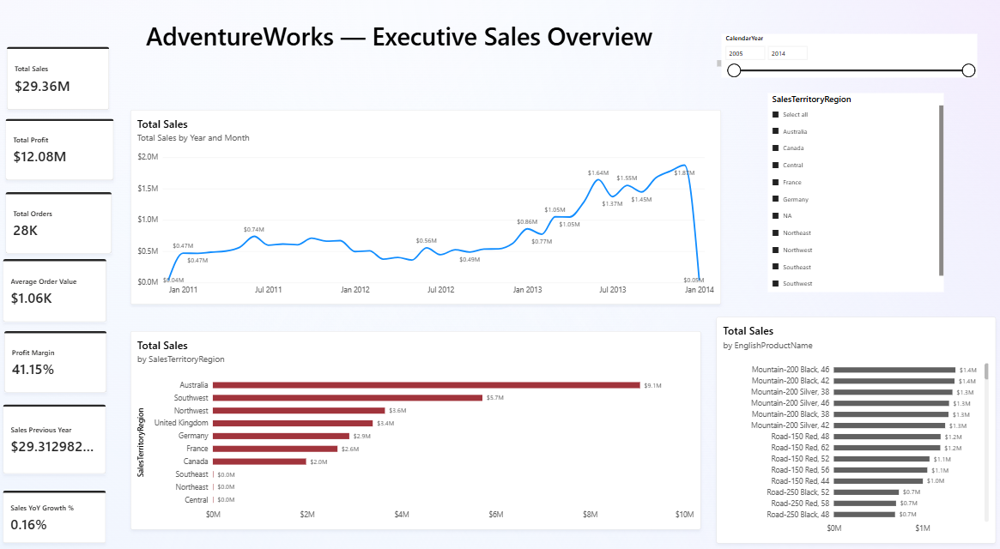
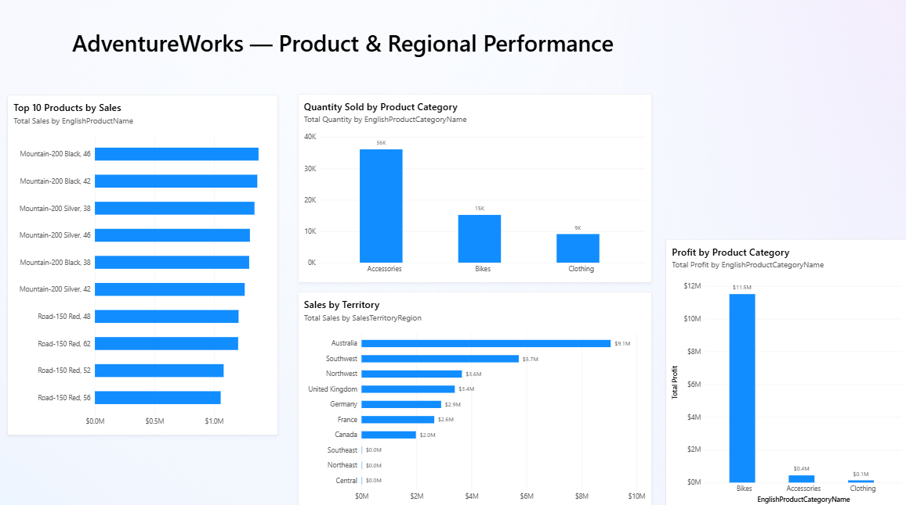
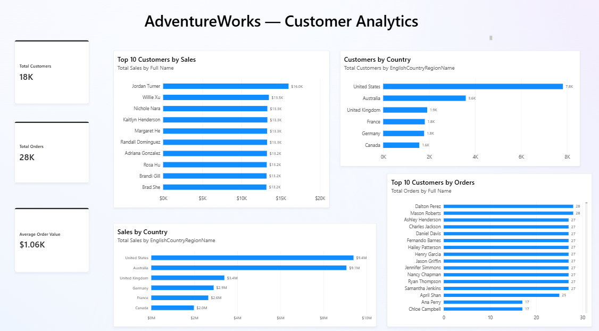

# AdventureWorks Sales & Customer Analytics

## Project Overview

This project analyzes sales performance, product performance, and customer behavior using the AdventureWorks data warehouse.

The goal is to transform raw business data into an interactive Power BI dashboard that helps stakeholders understand sales trends, profitability, product performance, and customer distribution.

## Business Objectives

- Monitor overall sales and profit performance.
- Identify top-performing products and product categories.
- Analyze sales performance across territories and countries.
- Understand customer purchasing behavior.
- Track order volume, average order value, and sales growth.

## Tools & Technologies

- **SQL Server 2022 Developer Edition** – Database storage and data exploration.
- **SQL Server Management Studio (SSMS)** – SQL querying and database management.
- **Power BI Desktop** – Data modeling, DAX calculations, and visualization.
- **DAX** – Business calculations and analytical measures.
- **Power Query** – Data preparation and transformation.

## Dataset

The project uses the AdventureWorksDW2022 sample data warehouse.

Key tables include:

- FactInternetSales
- DimCustomer
- DimProduct
- DimDate
- DimSalesTerritory
- DimProductCategory
- DimProductSubcategory
- DimGeography

## Data Model

The project uses a dimensional model with a central sales fact table connected to supporting dimension tables.

The model supports analysis by date, customer, product, product category, sales territory, and geography.

## Key DAX Measures

- Total Sales
- Total Cost
- Total Profit
- Total Orders
- Total Quantity
- Average Order Value
- Total Customers
- Profit Margin
- Sales Previous Year
- Sales YoY Change
- Sales YoY Growth %

## Dashboard Pages

### 1. Executive Sales
Provides an overview of business performance through KPI cards, monthly sales trends, category performance, and territory performance.

### 2. Product & Regional Performance
Highlights top-selling products, category profitability, quantity sold, and sales by territory.

### 3. Customer Analytics
Analyzes customer counts, top customers by sales and orders, and customer sales distribution by country.

## Business Value

The dashboard provides an interactive view of sales and customer performance, helping stakeholders explore trends, compare product categories, and identify important customer and regional segments.

## Project Files

- Power BI report (.pbix)
- SQL scripts (.sql)
- Dashboard screenshots
- Project documentation (README.md)
## Dashboard Preview

### Executive Sales

### Product & Regional Performance

### Customer Analytics

**Tools:** SQL Server | SSMS | Power BI | DAX | Power Query
